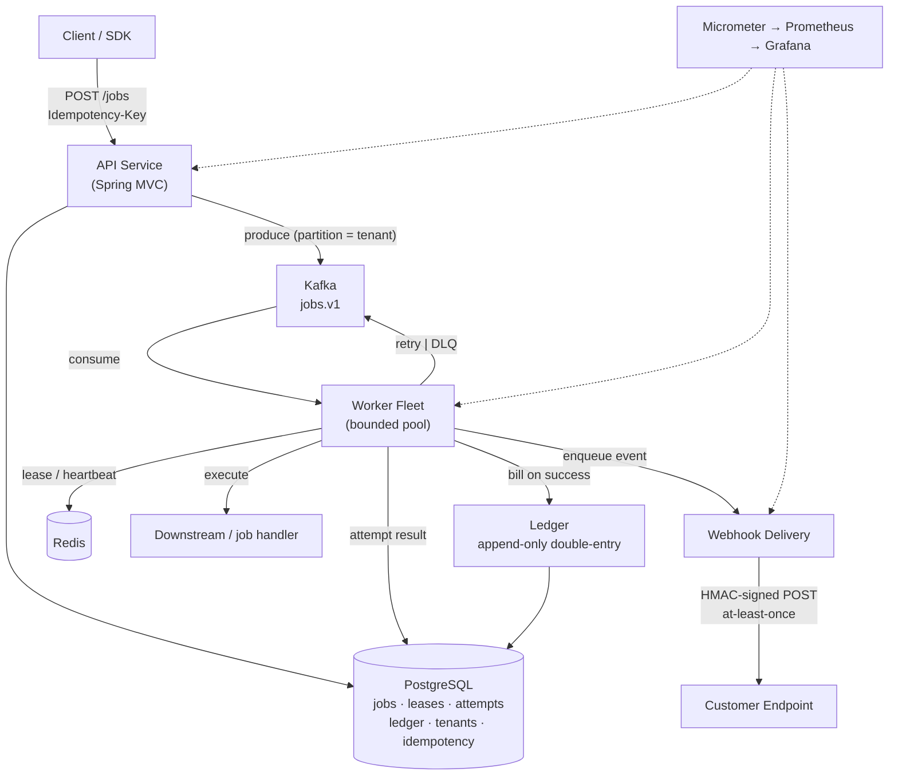
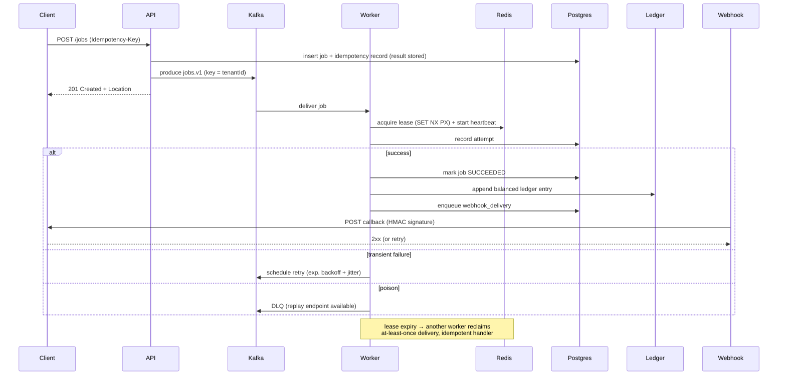

# Plan: Spring Orchestra

**Created:** 2026-09-18
**Status:** Approved
**Track:** Java project (`s3` slot) · Weeks 0–15 · ~245 min/week
**Builds on:** `2026-09-18-spring-ramp-up.md`

## Overview

Spring Orchestra is a multi-tenant **job orchestration platform**: clients submit jobs over an HTTP API, a fleet of workers leases and executes them, results are delivered to customers via signed webhooks, and every billable unit of work lands in an append-only double-entry ledger. It is the capstone that turns "I know Java" into "I have run a distributed system" — the artifact that carries the CV deep-dive and system-design rounds at Adobe, Stripe, UiPath and Thales.

It is built incrementally across weeks 0–15 at ~40 min/day plus 45 min Saturday. The point is not to finish a product; it is that each week produces a working increment *and* a story you can defend out loud. Applications go out in **week 8**, so early loops are calibration, not the finish line.

## Goals & non-goals

**Goals**
- A deployable, demoable, single-command-runnable system by week 14.
- Concurrency, messaging, persistence, idempotency and observability implemented *deliberately* — hand-written where the framework would hide the reasoning.
- Every subsystem tied to a concrete interview answer (which company asks it and why).
- A one-page design doc and a five-minute README that let a stranger run it.

**Non-goals**
- Microservices for their own sake — this is a modular monolith that *can* be split.
- Kubernetes, multiple clouds, or IaC beyond a local Docker Compose (the learner already has Terraform/AWS; the gap is distributed-systems reasoning, not infra).
- A polished frontend. Orchestra is an API; the "website" track is separate.
- Using framework annotations for the things interviews probe (see the "keep out of Spring's hands" rule).

## Architecture

**Style:** modular monolith with strongly separated packages, one deployable, designed so job-dispatch and the worker fleet can be extracted into separate services later. Synchronous reads/writes hit Postgres; asynchronous work flows through Kafka; leases and dedup live in Redis.

**Components**
- **API service** — job submission/retrieval, tenants, auth, pagination, idempotency keys, error contract.
- **Job dispatch** — produces job messages to Kafka (partitioned by tenant).
- **Worker fleet** — consumes, leases, executes, heartbeats, retries, dead-letters.
- **Ledger** — append-only double-entry entries, derived balances, conservation invariant.
- **Webhook delivery** — HMAC-signed, at-least-once, consumer-idempotent, replayable.
- **Multi-tenancy layer** — tenant-scoped query enforcement, per-tenant rate limiting, quotas/fair scheduling.
- **Observability** — Prometheus/Grafana, structured logs with trace ids, SLOs and error budgets.

**Data stores:** PostgreSQL (jobs, leases, attempts, ledger, tenants, idempotency), Redis (lease/dedup/rate-limit counters), Kafka (job dispatch + webhook outbox events).

**Domain model:** `Tenant → Job → Attempt → Lease → LedgerEntry`, with `WebhookDelivery` and `IdempotencyKey` as supporting records.

**Job lifecycle (sequence):**

## Tech stack & rationale

| Concern | Choice | Why | Hand-written? |
|---|---|---|---|
| Language | Java 21 | Target JDs; records, virtual threads available. | — |
| Framework | Spring Boot 4.1.x / Spring 7 | Web, DI, config, Actuator — the "boring" parts. | — |
| Build | Maven (repo uses `pom.xml`) | Enterprise-ubiquitous; one build tool only. | — |
| Web | Spring Web (WebMVC) | Thread-per-request is a teachable constraint. | — |
| Persistence | Spring Data JPA + `JdbcTemplate` | JPA for CRUD, raw SQL where it matters. | partial |
| Migrations | Flyway | Versioned schema; proves schema-design thinking. | — |
| Database | PostgreSQL (Docker Compose) | Isolation levels, locking, indexes, EXPLAIN. | — |
| Messaging | Apache Kafka | Partitioning, consumer groups, offsets, rebalancing. | — |
| Lease/dedup/rate-limit | Redis | Lease TTL, idempotency TTL, token buckets. | — |
| Worker concurrency | `ThreadPoolExecutor` + `BlockingQueue` | Must be able to say how it was sized. | **yes** |
| Retries | Exponential backoff + jitter | `@Retryable` would hide semantics Stripe/UiPath probe. | **yes** |
| Lease/heartbeat | Custom | This is the part UiPath is actually interested in. | **yes** |
| Ledger invariants | Plain Java + tests | No framework between you and a conservation check. | **yes** |
| Stripe HTTP drill | `java.net.http` + Jackson | Deliberate; no `RestTemplate`/`WebClient`. | **yes** |
| Metrics | Micrometer + Prometheus + Grafana | RED/USE, histograms, SLOs; Adobe Resilience. | — |
| Tests | Spring Boot test slices, Testcontainers | Contract vs wiring; real Postgres/Kafka. | — |
| Load/chaos | k6 or Gatling; JVM profiler | Find the real bottleneck, don't guess. | — |

## Best practices & conventions

- **Package by feature**, not by layer: `jobs/`, `workers/`, `ledger/`, `webhooks/`, `tenants/`, `observability/`.
- **Constructor injection; beans stateless.** Any mutable field on a singleton is a data race under thread-per-request.
- **All resources bounded.** Thread pool, queue, retry budget, connection pool, visibility timeout — every one has a number and a reason.
- **Idempotency everywhere work can repeat.** Client-supplied key on POST; consumer-side dedup for webhooks; idempotent job handlers.
- **Money is integer minor units + currency code.** Never `float`/`double`. Balances are derived, never a stored mutable column.
- **One error contract** (`code`, `message`, `field`) shared by the whole API.
- **Config via `@ConfigurationProperties` records**, validated at startup; profiles for `dev`/`test`/`prod`.
- **Observability is a feature**, not an afterthought: every job carries a trace id from submission to webhook.
- **Commit from day one**, small and meaningful; the history is interview material.

## Data model (sketch)

- **tenants** — `id`, `name`, `api_key_hash`, `rate_limit_per_sec`, `quota_per_day`, `created_at`.
- **jobs** — `id`, `tenant_id`, `type`, `payload jsonb`, `status` (`PENDING|RUNNING|SUCCEEDED|FAILED|DEAD`), `idempotency_key`, `version` (optimistic lock), `created_at`, `updated_at`.
- **attempts** — `id`, `job_id`, `attempt_no`, `worker_id`, `started_at`, `finished_at`, `outcome`, `error`.
- **leases** — `job_id`, `worker_id`, `lease_expires_at`, `heartbeat_at`, `visibility_timeout`.
- **ledger_entries** — `id`, `tenant_id`, `job_id`, `account`, `direction` (`DEBIT|CREDIT`), `amount_minor` (bigint), `currency`, `created_at`. **Append-only; no UPDATE/DELETE.**
- **webhook_deliveries** — `id`, `tenant_id`, `job_id`, `event_type`, `payload`, `signature`, `status`, `attempts`, `next_retry_at`, `delivered_at`.
- **idempotency_keys** — `key`, `tenant_id`, `request_hash`, `response_status`, `response_body`, `expires_at`.

Indexes: `jobs(tenant_id, status, created_at desc)` for list queries; `jobs(idempotency_key, tenant_id)` unique; `leases(lease_expires_at)` for reclamation sweep; `ledger_entries(tenant_id, created_at)`.

## Implementation plan

### Week 0 — Baseline & scaffold
- **Objective:** A deliberately light week: measure where you are and stand up the two things everything runs on — the Orchestra repo and a working interview environment.
- **Steps:**
  1. Generate the repo: Gradle **or** Maven + Spring Boot + PostgreSQL via Docker Compose. Commit from day one.
  2. Run the Spring Ramp Up exercises 1–4 (see the Ramp plan). **Do not start Orchestra properly.**
  3. Verify the interview toolchain: the debugger hits a conditional breakpoint, the test runner works from a cold start, and `git` auth works against a private remote.
  4. Turn Copilot/AI assistants off permanently.
- **Why:** You cannot debug a distributed system with tools you haven't proven. The repo *is* the interview environment.
- **Definition of Done:** `docker compose up` + `./mvnw spring-boot:run` boots a hello-world service; a conditional breakpoint is hit; a test runs green from cold; a commit is pushed.
- **Interview signal:** All four companies. Working fluency, not trivia.

### Week 1 — The API layer
- **Objective:** Model the resource properly and lock down the public contract.
- **Steps:**
  1. Finish Ramp Up exercises 5–8.
  2. `POST /jobs` (submit) and `GET /jobs/{id}`, `GET /jobs` (list) endpoints.
  3. Model the resource deliberately — a job has a type, a payload, a state machine — not CRUD-by-reflex.
  4. Add pagination (cursor or keyset, not `OFFSET` blind) and reuse the Ramp error contract.
  5. Add **idempotency keys on POST**: client supplies `Idempotency-Key`; persist key + request hash + the *full response body* server-side so a replay returns the original result, not just a "seen" marker.
  6. Read Stripe's public API reference for the *texture* of an interface designed to be hard to misuse.
- **Why:** Idempotency stored with the response body is a subtle, senior-level distinction. Reading Stripe's reference changes how you name and shape everything that follows.
- **Definition of Done:** A replayed `POST` with the same key returns the identical `201` body; a different key creates a new job; list is paginated; errors use the one contract.
- **Interview signal:** **Stripe** (API design is scored directly) and **UiPath**. HIGH STAKES.

### Week 2 — Persistence done properly
- **Objective:** A schema and transaction model you can defend.
- **Steps:**
  1. Design the schema; version every change with **Flyway** migrations.
  2. Implement transactions and reason about **isolation levels** — demonstrate what read-committed allows and what repeatable-read prevents (write a test that shows a lost update at the wrong level).
  3. Add **optimistic locking** with a `version` column on `jobs`.
  4. Add indexes that match actual query patterns; run `EXPLAIN (ANALYZE)` on the slowest query and fix what it reveals.
  5. Write down what you chose and why (this paragraph is interview material).
- **Why:** Schema design is half of what a mid-level system-design round scores. Isolation and locking are where interviews separate readers from builders.
- **Definition of Done:** Migrations create the full schema from scratch; an isolation/concurrency test proves the chosen level; an EXPLAIN before/after is documented.
- **Interview signal:** **Adobe, Stripe, UiPath, Thales**.

### Week 3 — Concurrency core
- **Objective:** A deliberately-configured executor and a shutdown that drains.
- **Steps:**
  1. Build a **bounded work queue** + `ThreadPoolExecutor`; write down core/max size, queue capacity, rejection policy, and thread naming.
  2. Implement **graceful shutdown** that actually drains in-flight work (and a timeout after which it stops anyway).
  3. Study the Java memory model: `volatile`, happens-before, visibility vs atomicity — write a small demonstration of a visibility bug.
  4. Choose `synchronized` vs `ReentrantLock` for a real structure and justify it.
  5. **No `@Async`.** Hand-write it all. Remember singleton beans are shared across request threads.
- **Why:** "How did you size your thread pool, and what happens when the queue fills?" is close to guaranteed at Adobe and UiPath. `@Async` makes you unable to answer it.
- **Definition of Done:** Under load the executor rejects/queues per policy; shutdown drains then exits; documented queue-fill behaviour.
- **Interview signal:** **Adobe, UiPath**. HIGH STAKES.

### Week 4 — Kafka: dispatch and semantics
- **Objective:** Real asynchronous job dispatch with understood failure modes.
- **Steps:**
  1. Add a Kafka producer + consumer wired into job dispatch.
  2. **Partition by tenant**; write down why that choice constrains ordering and scaling later.
  3. Learn consumer groups + **rebalancing**; observe what happens to in-flight work during one.
  4. Decide offset management: commit **before** vs **after** processing, and the failure mode of each (at-most-once vs at-least-once).
- **Why:** UiPath and Adobe both run Kafka; this makes the CV claim bulletproof and sets up leases/retries.
- **Definition of Done:** Jobs flow client → Kafka → worker; a killed consumer redelivers; offset strategy documented with its failure mode.
- **Interview signal:** **Adobe, Stripe, UiPath**. HIGH STAKES.

### Week 5 — The worker fleet
- **Objective:** Leased work with liveness — the core UiPath idiom.
- **Steps:**
  1. Workers **lease** jobs (don't lock them): acquire with `SET NX PX` in Redis (or a lease row) and record `lease_expires_at`.
  2. Send **heartbeats**; on lease expiry another worker **reclaims** work from a worker that died mid-job.
  3. Deliver **at-least-once** and make job handlers **idempotent** so repetition is safe.
  4. Size the **visibility timeout** deliberately (longer than the 99th-percentile job, shorter than tolerable double-work).
  5. **Kill a worker mid-job** and watch what happens; fix what you find.
- **Why:** This is the subsystem UiPath is actually interested in, and at-least-once + idempotency is the heart of every distributed system interview.
- **Definition of Done:** Kill test shows reclaim + no lost job; a duplicate delivery does not double-execute; timeout rationale written down.
- **Interview signal:** **UiPath, Stripe**. HIGH STAKES.

### Week 6 — Retries and the DLQ
- **Objective:** Failure handling that cannot be weaponised.
- **Steps:**
  1. **Exponential backoff with jitter** — and be able to say why jitter matters (thundering herd).
  2. Add a **retry budget** so a poison message cannot consume the whole fleet.
  3. Add a **dead-letter queue** with a **replay endpoint**.
  4. Use **Redis** as the dedup store behind idempotency keys, with a TTL you can justify.
  5. **No `@Retryable`** — hand-write it.
- **Why:** Stripe and UiPath both probe retry semantics; "retry budget" is the answer that shows operational maturity.
- **Definition of Done:** A poison message dead-letters after N attempts without stalling the fleet; replay reprocesses; TTL rationale documented.
- **Interview signal:** **Stripe, UiPath**. HIGH STAKES.

### Week 7 — The ledger
- **Objective:** A double-entry ledger that can prove itself.
- **Steps:**
  1. **Append-only** entries — never update a row.
  2. Balanced **debits and credits**, with a **conservation invariant** enforced by a test that runs on every build.
  3. Balances are **derived state**, never a mutable column.
  4. Money as **integer minor units**; currency code alongside every amount; never floats.
- **Why:** This single subsystem gives a concrete answer to half of Stripe's design prompts and demonstrates correctness thinking.
- **Definition of Done:** Conservation test green on every build; derived balance matches sum of entries; no floating-point money anywhere.
- **Interview signal:** **Stripe**. HIGH STAKES.

### Week 8 — Webhooks — and you start applying
- **Objective:** Deliver signed events at-least-once, and get applications out.
- **Steps:**
  1. **HMAC** signature generation; document verification from the consumer side.
  2. At-least-once delivery with **consumer-side idempotency**.
  3. State explicitly in the docs that **ordering is not guaranteed**.
  4. Add a **replay endpoint** for a customer who lost a window of events.
  5. **APPLY** to the target roles this week (UiPath Software Engineer 2+ yrs and SE II, Bitpanda Golang, Stripe Connect Tax Reporting). Tailor the CV per company; ask every recruiter for the exact loop composition in writing.
- **Why:** Webhook signing + idempotency is exactly Stripe's home turf, and applying in week 8 is the one hard deadline in the plan.
- **Definition of Done:** Signed webhooks verified by a test consumer; duplicate delivery is idempotent; applications sent.
- **Interview signal:** **Stripe**. HIGH STAKES · **APPLY WEEK**.

### Week 9 — Multi-tenancy
- **Objective:** Isolation and fairness that cannot leak or starve.
- **Steps:**
  1. **Tenant-scoped data partitioning**, enforced at the query layer so accidental cross-tenant reads are impossible.
  2. **Per-tenant rate limiting** using your own token bucket (from the System Design track).
  3. **Quotas and fair scheduling** so one tenant cannot starve the fleet.
  4. Write a **test proving tenant A cannot read tenant B's jobs**.
- **Why:** Multi-tenancy is UiPath's core design idiom; "noisy neighbour" and fair scheduling are senior signals.
- **Definition of Done:** Cross-tenant read test fails closed; rate limit isolates a hot tenant; fairness verified.
- **Interview signal:** **UiPath, Stripe**. HIGH STAKES.

### Week 10 — Observability
- **Objective:** Operate the system, not just build it.
- **Steps:**
  1. **Prometheus** metrics following **RED** (Rate, Errors, Duration) and **USE** (Utilisation, Saturation, Errors) — **histograms, not averages**.
  2. Recording rules and a **Grafana dashboard** you would put on a wall.
  3. **Structured logging** with a **trace id** threaded through the job lifecycle.
  4. Define real **SLOs** and an **error budget**; write the **runbook** for breaching them.
- **Why:** This is the Adobe Identity Resilience role in miniature, and it converts the learner's Terraform/AWS background into reliability vocabulary.
- **Definition of Done:** Dashboard shows job latency/error histograms; logs correlate by trace id; SLO + runbook committed.
- **Interview signal:** **Adobe**. HIGH STAKES.

### Week 11 — Hardening: resilience and identity
- **Objective:** Survive downstream failure and secure the API.
- **Steps:**
  1. **Circuit breakers and bulkheads** around every downstream call (hand-written or with a deliberately-chosen library, but understand it).
  2. **Backpressure** when queue depth grows instead of falling over.
  3. **Auth** on the API — API keys or OAuth2 client credentials, **scoped per tenant**.
  4. Handle **secrets** properly; ensure nothing sensitive reaches the logs.
- **Why:** Abstract network topics become concrete; security scoping is a common mid-level screen.
- **Definition of Done:** A flaky downstream degrades gracefully; depth triggers backpressure; unauthenticated and cross-tenant calls are rejected.
- **Interview signal:** **Adobe, Stripe**.

### Week 12 — Chaos and load
- **Objective:** Break it on purpose, then measure and fix.
- **Steps:**
  1. Chaos: kill a worker mid-job, partition Kafka, fill the disk, blackhole Postgres — fix what breaks.
  2. **Load test** with **k6** or **Gatling**; find the actual bottleneck — do not guess.
  3. **Profile the JVM**: find a GC pause, tune the heap, measure the difference.
- **Why:** "Diagnose a production OOM or long GC pause" is a near-certain Adobe resilience question; now you've really done it.
- **Definition of Done:** Chaos findings + fixes written up; load-test bottleneck identified with evidence; GC change measured.
- **Interview signal:** **Adobe, UiPath**. HIGH STAKES.

### Week 13 — The design doc and README
- **Objective:** Convert the build into an interview artifact.
- **Steps:**
  1. Write the **one-pager**: problem, constraints, key decisions, alternatives rejected and why, failure modes, what you would do differently.
  2. Write a **README** that lets a stranger run it in under five minutes.
- **Why:** Stripe is a writing-first culture; Thales's manager round is essentially this document, spoken. This doubles as writing practice.
- **Definition of Done:** One-pager and README committed; a stranger can run the system from the README alone.
- **Interview signal:** **Adobe, Stripe, UiPath, Thales**. HIGH STAKES.

### Week 14 — Freeze, deploy, demo
- **Objective:** Make it deployable and demoable and stop adding features.
- **Steps:**
  1. Freeze features. A **single command** runs the whole system; record a short screencast or prepare a live demo.
  2. Re-read your own code as a stranger would; fix the **three worst readability** problems.
- **Why:** Shipped beats complete; the demo is the CV deep-dive asset.
- **Definition of Done:** `docker compose up` (or one script) runs everything; demo rehearsed; three readability fixes committed.
- **Interview signal:** All four.

### Week 15 — Keep it alive
- **Objective:** Use Orchestra as a cold-reading playground during live interviews.
- **Steps:**
  1. Keep it deployable.
  2. **Bug Squash:** have a friend inject a bug into a branch; find it cold, timed.
- **Why:** The best possible refresher before a CV deep-dive round.
- **Definition of Done:** Bug found and explained under time pressure; system still deployable.
- **Interview signal:** All four.

## Testing strategy

- **Fast slice tests** (`@WebMvcTest` + MockMvc) for the API contract and error shape.
- **Full-context tests** (`@SpringBootTest` + Testcontainers) for Postgres, Kafka and wiring — real brokers/DBs, not mocks, for anything concurrency- or semantics-sensitive.
- **Invariant tests:** ledger conservation (every build), idempotency-replay, multi-tenant isolation (opt-in).
- **Concurrency/lease tests:** duplicate-delivery safety and lease reclaim on worker death.
- **Chaos + load** (weeks 12–14): repeatable scripts so the findings can be re-demonstrated in an interview.

## Acceptance criteria

- [ ] `POST /jobs` with an `Idempotency-Key` returns `201 + Location`; a replay returns the identical stored response.
- [ ] Jobs are paginated; all errors share the single `{code,message,field}` contract.
- [ ] Schema is Flyway-managed; isolation level chosen and justified; optimistic locking on `jobs`; at least one EXPLAIN-driven index.
- [ ] A hand-written bounded `ThreadPoolExecutor` with documented sizing, rejection policy and graceful drain.
- [ ] Kafka job dispatch partitioned by tenant; offset strategy and its failure mode documented; rebalancing observed.
- [ ] Workers lease jobs, heartbeat, and reclaim on lease expiry; killing a worker loses no work.
- [ ] Retries use exponential backoff + jitter with a retry budget; DLQ + replay endpoint work; dedup store has a justified TTL.
- [ ] Ledger is append-only, balanced, with a conservation test on every build; money is integer minor units + currency.
- [ ] Webhooks are HMAC-signed, at-least-once, consumer-idempotent; ordering non-guarantee documented; replay endpoint exists.
- [ ] Tenant-scoped partitioning enforced at the query layer; per-tenant token-bucket rate limiting; a test proves isolation.
- [ ] Prometheus histograms (RED/USE), Grafana dashboard, structured logs with trace ids, SLOs + error budget + runbook.
- [ ] Circuit breakers/bulkheads, backpressure, per-tenant auth, and no secrets in logs.
- [ ] Chaos scenarios executed and fixed; load-test bottleneck found with evidence; JVM GC tuned and measured.
- [ ] One-page design doc + five-minute README; single-command run; demo recorded.
- [ ] "Keep out of Spring's hands" rule honoured: thread pool, retries, leases, ledger invariants and the Stripe HTTP drill are hand-written.

## Risks & gotchas

1. **Beans are singletons; thread-per-request means your fields race.** No event loop protects you. Keep services stateless; per-request state in locals.
2. **Self-invocation defeats `@Transactional`/`@Async`/`@Cacheable`.** Proxy-based; `this.foo()` silently skips it.
3. **Checked exceptions don't roll back by default** — use `rollbackFor`, deliberately.
4. **JPA lazy loading and N+1.** Touching a lazy collection in a loop fires a query per row; outside a transaction it throws. Fetch-join or drop to SQL.
5. **Thread-per-request ceiling.** Default Tomcat pool ≈ 200; a slow downstream holds a thread for its whole duration. This *is* the backpressure week-11 topic.
6. **At-least-once is the honest default.** Design handlers idempotent rather than pretending exactly-once exists.
7. **Retry storms.** Without jitter and a budget, one outage becomes a thundering herd.
8. **Timeboxing risk.** ~245 min/week is tight; the plan is ordered so a slipped week costs the *build*, not the week-8 applications. Slip behind on Orchestra, never on applying.
9. **Scope creep.** Week 14 freezes features on purpose; week 7 forces cutting a half-built feature.

## Notes

- **Source:** scraped live from `localhost:5173` (career-prep Vite app) — `src/data/weeks.ts` (Java/Orchestra block for weeks 0–15), `src/data/spring.ts` (on-ramp), `src/data/tracks.ts` (time budget: Java = `s3`, ~245 min/week).
- **Produced without the `sam-software-architect` subagent.** That agent, and the `sam-ui-designer`, fail with `Model not found: inherit/.`; this plan was authored directly. Recommend fixing the agent model config before relying on `/workflows:sam-implement`.
- **No UI design system requested** — Orchestra is an API project; the separate "website" track owns the user-facing site.
- Companies tagged per week mirror the curriculum's own `companies` / `highStakes` flags.
- Architecture diagrams are embedded as Mermaid source; no `.mmd`/`.png` were exported because the diagram skill's agents are unavailable in this environment.
