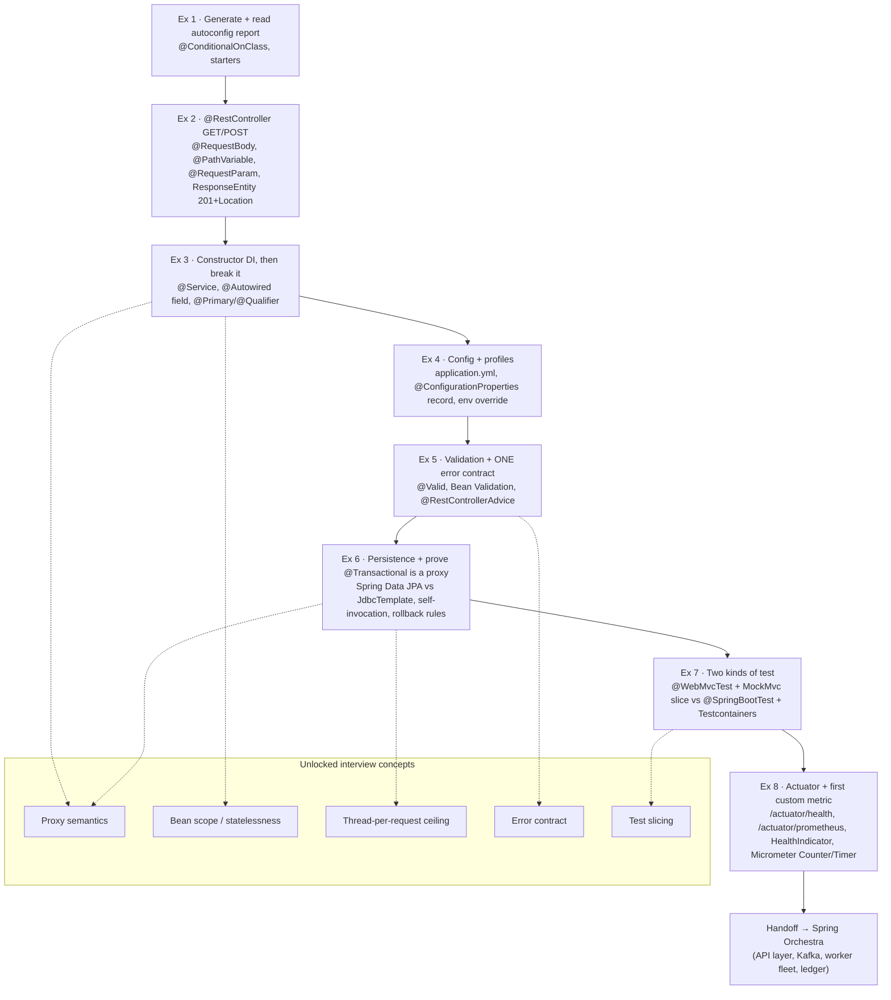

# Plan: Spring Ramp Up

**Created:** 2026-09-18
**Status:** Approved
**Track:** Java project (`s3` slot) · Weeks 0–1 · ~245 min/week
**Prerequisite for:** Spring Orchestra

## Overview

Spring Ramp Up is an eight-exercise, hands-on Spring Boot on-ramp totalling just under seven hours. It exists to close one specific gap: the learner has real Java on the CV (Cloud Services work, a JSoup scraper, a billing service) but no framework experience. That gap is what Adobe's "J2EE stack" and Thales's "Java & Angular" postings screen for, while UiPath and Stripe genuinely do not care which framework is used.

Because the learner comes from Node/Nest, most of this is a vocabulary swap rather than a new mental model — Nest borrowed heavily from Spring. The sequence is arranged so every exercise produces something runnable, and three of them ask the learner to *break* something on purpose, because the concepts Spring hides are exactly the ones interviewers probe.

## Goals & non-goals

**Goals**
- Stand up a Spring Boot service and understand what auto-configuration actually did.
- Be fluent in constructor injection, configuration binding, validation, and one deliberate error contract.
- Understand — by demonstration, not by reading — how `@Transactional` proxying works and where it fails.
- Distinguish a fast slice test from a full-context integration test and know when to use each.
- Produce a first custom metric and health indicator.
- Build the muscle that keeps hand-written concerns (thread pools, retries, leases, ledger invariants) out of framework annotations.

**Non-goals**
- Building the capstone. Orchestra starts properly in week 2; week 0 explicitly says *do not* start it.
- Spring Security, reactive stack, or Spring Cloud (deferred to Orchestra weeks 11+).
- Production deployment. This is a local practice repo that doubles as the interview environment.

## Architecture

The on-ramp is deliberately a single small service, built up exercise by exercise on top of the generated skeleton. Each exercise adds one layer and one *conceptual* unlock. The progression:



Single package root `com.carrer_prep.spring_ramp_up`, layered as it grows:

```
demo/
  web/        controllers, DTO records, @RestControllerAdvice
  service/    @Service classes (constructor-injected)
  repo/       Spring Data interfaces + one JdbcTemplate DAO
  config/     @ConfigurationProperties records
  health/     custom HealthIndicator
```

## Tech stack & rationale

| Concern | Choice | Why |
|---|---|---|
| Language | Java 21 | LTS, matches the target JDs and enables records + virtual threads later. |
| Framework | Spring Boot 4.1.x (repo parent is 4.1.1) | Auto-config + starters is the thing being learned; Boot 4 / Spring 7 keeps it current. |
| Build | Maven (repo already uses `pom.xml`) | Declarative, ubiquitous in enterprise Java shops; Gradle is an acceptable swap but keep one. |
| Web | `spring-boot-starter-webmvc` | Thread-per-request model is the point (contrast with Node's event loop). |
| Validation | `spring-boot-starter-validation` | Drives the single error contract. |
| Persistence | `spring-boot-starter-data-jpa` + `JdbcTemplate` | Need both to *prove* the proxy/derive-query behaviour. |
| Migrations | Flyway | Schema as versioned code; used heavily in Orchestra week 2. |
| Database | PostgreSQL via Docker Compose (H2 only as a stop-gap) | Real DB for Testcontainers and realistic isolation/locking. |
| Metrics | Actuator + Micrometer + Prometheus registry | On-ramp to Orchestra week 10 / the Adobe Identity Resilience role. |
| Tests | Spring Boot test starters, MockMvc, Testcontainers | Slice vs full-context contrast is the lesson. |

## Best practices & conventions

- **Constructor injection always.** Fields `final`; no `@Autowired` on fields outside the deliberate exercise 3 break.
- **Beans are stateless.** No mutable instance fields — request state lives in method parameters/locals. (Spring MVC is thread-per-request with a shared singleton bean.)
- **One error shape.** All failures leave the API as `{ code, message, field }` via `@RestControllerAdvice`; never leak the default Whitelabel/Spring error body.
- **Bind config to validated records.** `@ConfigurationProperties` + constraints; no scattered `@Value`. Bad config must fail at startup.
- **Precedence is law:** env var > profile file > base file. Prove it, don't assume it.
- **Commit from day one.** Small, meaningful commits; interviewers read history.
- **No AI assistant in this repo.** Copilot off permanently — you will not learn a framework with one on.

## Implementation plan

### Week 0 — Framework under your hands (exercises 1–4)

Do **not** start Orchestra this week. The goal is reflexes.

#### Exercise 1 — Generate one and read what you got (45 min)
- **Objective:** See that Spring Boot is *conditional* configuration, not magic.
- **Steps:**
  1. Go to start.spring.io; select Web, Validation, Actuator, Data JPA, PostgreSQL, Flyway; Java 21; generate.
  2. Run `./mvnw spring-boot:run` once to confirm it starts (add an H2 runtime dep or a Compose Postgres so it boots).
  3. Run with `--debug` and read the **auto-configuration report** (`Positive matches` / `Negative matches`).
  4. Find the entry that turned on `DataSourceAutoConfiguration` because `org.postgresql.Driver` is on the classpath.
- **Why / what to notice:** The report is the whole trick. Every starter is `@ConditionalOnClass` / `@ConditionalOnMissingBean` all the way down. Nothing configured itself "implicitly" — a class appeared and a condition fired.
- **Definition of Done:** You can point at the report line that auto-configured the `DataSource`, and state what would happen if you removed the Postgres driver.
- **Time:** 45 min.

#### Exercise 2 — A controller and an honest status code (45 min)
- **Objective:** Understand request mapping and return the *correct* status yourself.
- **Steps:**
  1. Write one `@RestController` with a `GET` and a `POST`.
  2. Use `@RequestBody` (POST body), `@PathVariable` (GET by id), `@RequestParam` (GET filter).
  3. Return `ResponseEntity`: `200` for reads, and for the POST build `ResponseEntity.created(URI.create("/things/" + id)).body(created)` so you emit **201 + `Location`**.
  4. Exercise it with `curl.exe -i` (not a browser). On Windows PowerShell, send JSON via a file: `curl.exe -s -i -H "Content-Type: application/json" -d "@body.json" http://localhost:8080/...` (PowerShell mangles escaped quotes inline).
- **Why / what to notice:** You wrote no routing table and started no server. Nest hides exactly the same machinery because it copied this design — `@RestController` is `@Controller` + `@ResponseBody`.
- **Definition of Done:** `curl -i` shows `201` with a `Location` header; browser dependency ruled out.
- **Time:** 45 min.

#### Exercise 3 — Dependency injection, then break it on purpose (45 min)
- **Objective:** Feel the difference between constructor and field injection.
- **Steps:**
  1. Add a `@Service`, inject it into the controller via the **constructor** (field `final`).
  2. Deliberately switch to `@Autowired` on the field; observe it still "works".
  3. Introduce a second implementation of the same interface; watch the app **refuse to start** (`NoUniqueBeanDefinitionException`).
  4. Fix it with `@Primary`, then again with `@Qualifier`.
- **Why / what to notice:** Constructor injection keeps the field `final`, makes the class testable with plain `new`, and surfaces circular dependencies at startup. Field injection hides all three. Spring won't scold you; interviewers will.
- **Definition of Done:** You can explain the startup failure and both fixes; constructor injection is restored.
- **Time:** 45 min.

#### Exercise 4 — Configuration and profiles (40 min)
- **Objective:** Externalise and validate configuration.
- **Steps:**
  1. Move hard-coded values into `application.yml`.
  2. Create a `@ConfigurationProperties` **record** grouping related values, with Bean Validation constraints.
  3. Add `dev` and `test` profiles (`application-dev.yml`, `application-test.yml`).
  4. Override one value with an environment variable and confirm which wins.
- **Why / what to notice:** Precedence — **env var > profile file > base file** — is what you'll need at 2am. A validated properties record fails at startup on bad config instead of at first request.
- **Definition of Done:** Written proof (a log line or actuator endpoint) that the env var won.
- **Time:** 40 min.

### Week 1 — Contract, persistence, tests, telemetry (exercises 5–8)

Finish the on-ramp, then roll straight into Orchestra's API layer (separate plan).

#### Exercise 5 — Validation and one consistent error contract (60 min) ⭐ highest value
- **Objective:** Replace Spring's default error soup with a single deliberate contract.
- **Steps:**
  1. Put `@Valid` on the request body; add `@NotBlank`, `@Positive`, `@Size` to the DTO record.
  2. Create `@RestControllerAdvice` with `@ExceptionHandler` methods for `MethodArgumentNotValidException`, a custom `NotFoundException`, and a catch-all `Exception`.
  3. Map everything into **one** JSON shape: a stable `code`, a human `message`, and the offending `field`.
- **Why / what to notice:** Out of the box Spring returns a sprawling body that leaks internals. A single error contract is one of the few things *every* interviewer notices — Stripe scores API design directly, Adobe scores error handling in the coding round. Worth more than the next three exercises combined.
- **Definition of Done:** A bad body, an unknown id, and a thrown exception all return the same JSON shape with `400`/`404`/`500` respectively.
- **Time:** 60 min.

#### Exercise 6 — Persistence — and prove `@Transactional` is a proxy (75 min) ⭐
- **Objective:** See proxy semantics with your own eyes.
- **Steps:**
  1. Write the same query twice: a Spring Data JPA repository interface, and a `JdbcTemplate` version.
  2. Put `@Transactional` on a method and call it **from another method in the same class**; observe the transaction not applying.
  3. Throw a **checked** exception inside a transaction; observe it **not** rolling back.
  4. Fix both deliberately: call through the injected proxy; add `@Transactional(rollbackFor = …)`.
- **Why / what to notice:** `@Transactional` wraps the bean in a proxy, so self-invocation bypasses it, and default rollback only covers unchecked exceptions. This is the single most common Spring bug in production — and a great answer to "what surprised you about the framework?"
- **Definition of Done:** You can demonstrate both failures and both fixes; write a one-paragraph explanation.
- **Time:** 75 min.

#### Exercise 7 — Two kinds of test (60 min)
- **Objective:** Choose the right test for the job, and feel the cost difference.
- **Steps:**
  1. `@WebMvcTest` slice + `MockMvc`, mocking the service — no database.
  2. `@SpringBootTest` + **Testcontainers** Postgres — real, slow.
  3. Time both; record the numbers.
- **Why / what to notice:** Slice tests pin the *contract*; one or two full tests pin the *wiring*. A suite that boots the whole context per case is why people say Java tests are slow.
- **Definition of Done:** Both suites green; timings recorded in the README.
- **Time:** 60 min.

#### Exercise 8 — Actuator and your first custom metric (45 min)
- **Objective:** Make the service observable.
- **Steps:**
  1. Expose `/actuator/health` and `/actuator/prometheus`.
  2. Write a custom `HealthIndicator` that reports `DOWN`/degraded when a dependency is unreachable.
  3. Register a Micrometer `Counter` and a `Timer` on a real code path and scrape them.
- **Why / what to notice:** This is the on-ramp to Orchestra week 10 (Prometheus, SLOs) and close to the entire Adobe Identity Resilience job description. Instrumenting now makes week 10 about interpretation, not plumbing.
- **Definition of Done:** `/actuator/prometheus` shows your custom counter/timer incrementing on real traffic.
- **Time:** 45 min.

## Testing strategy

- **Slice first:** `@WebMvcTest` for every controller contract; mock collaborators. Sub-second tests.
- **Full context sparingly:** `@SpringBootTest` + Testcontainers for wiring, transactions, and Flyway migrations — one or two, not one per case.
- **Invariant/proof tests:** exercise 6's proxy behaviour and rollback rules get explicit tests so the lesson is regression-proof.
- **Timing discipline:** record slice vs full timings; the contrast is part of the learning.

## Acceptance criteria

- [ ] App generated from start.spring.io with Web, Validation, Actuator, Data JPA, PostgreSQL, Flyway on Java 21.
- [ ] Auto-configuration report read and the `DataSource` condition identified.
- [ ] `@RestController` exposes an honest `201 + Location` on POST; exercised with `curl`, not a browser.
- [ ] Constructor injection used everywhere; field injection demonstrated once and reverted; `@Primary`/`@Qualifier` understood.
- [ ] Config bound to a validated `@ConfigurationProperties` record; `dev`/`test` profiles exist; env-var precedence proven.
- [ ] One consistent JSON error contract for validation, not-found, and unhandled errors.
- [ ] `@Transactional` self-invocation failure and checked-exception non-rollback both demonstrated and fixed.
- [ ] A fast slice test and a Testcontainers full test both exist; timings recorded.
- [ ] `/actuator/health` and `/actuator/prometheus` live; a custom `HealthIndicator`, `Counter`, and `Timer` exist.
- [ ] Copilot/AI assistance off; commit history from day one.

## Risks & gotchas

1. **Beans are singletons; you are not on an event loop.** One shared instance serves concurrent threads. Any mutable field is a data race. Keep beans stateless.
2. **Self-invocation defeats `@Transactional`/`@Async`/`@Cacheable`.** All proxy-based; `this.doThing()` skips the proxy silently.
3. **Checked exceptions don't roll back by default.** Use `rollbackFor` deliberately.
4. **JPA lazy loading + N+1.** Lazy collection outside a transaction → `LazyInitializationException`; inside a loop → a query per row. Use fetch joins or drop to `JdbcTemplate` and be able to say why.
5. **Thread-per-request has a hard ceiling.** Default Tomcat pool ≈ 200; a slow downstream call holds a thread for its full duration. This is the backpressure conversation in Orchestra week 11.
6. **PowerShell + curl quoting.** Post JSON from a file (`-d "@body.json"`) rather than inline `\"` escapes.
7. **H2 vs PostgreSQL.** H2 is a stop-gap only; isolation/locking behaviour differs and Orchestra week 2 requires real Postgres.

## Notes

- Produced without the `sam-software-architect` subagent — the agent failed with `Model not found: inherit/.`; this plan was authored directly from the scraped `localhost:5173` curriculum (`src/data/spring.ts`, `src/data/weeks.ts`).
- Week 0 is explicitly a *light* week and explicitly says not to start Orchestra; the plan keeps that boundary.
- Times sum to ~415 min against a ~245 min/week budget, so the on-ramp intentionally spills from week 0 into week 1 — the curriculum calls this out and notes it costs nothing, because the deadline that matters is applying in week 8.
