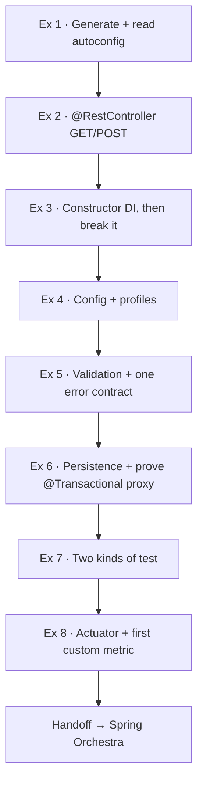
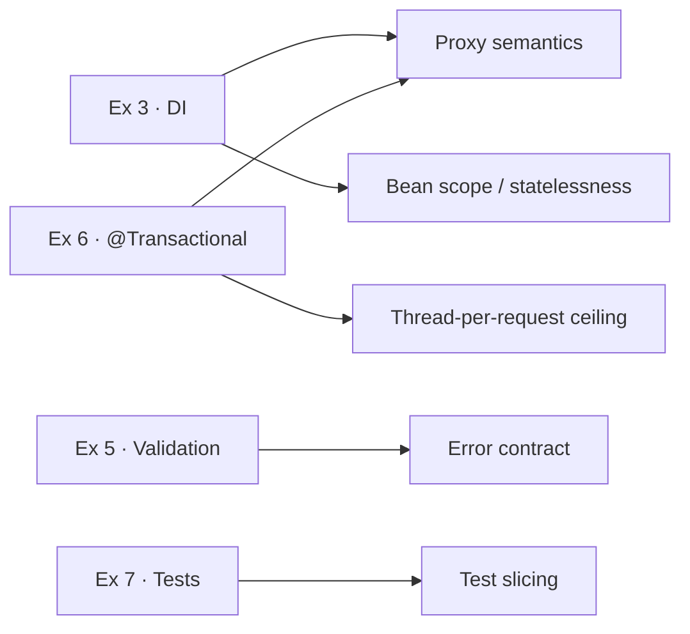

# Spring Ramp Up — 8 exercises

Eight hands-on Spring Boot exercises (just under 7 hours) that close one gap: the learner has real Java on the CV but no framework experience. It is a vocabulary swap for someone coming from Node/Nest, and three exercises break something on purpose, because the concepts Spring hides are exactly what interviewers probe.

<Stat>
- Exercises: 8
- Total time: ~415 min
- Window: Weeks 0–1
- Stack: Java 21 + Boot 4.1
</Stat>

## The progression

Each exercise adds one layer and one *conceptual* unlock, built up on the generated skeleton.



Every exercise also unlocks an interview concept:



<Chart type="bar" title="Time per exercise (minutes)">
- Ex 1 Generate: 45
- Ex 2 Controller: 45
- Ex 3 DI: 45
- Ex 4 Config: 40
- Ex 5 Error contract: 60
- Ex 6 @Transactional: 75
- Ex 7 Tests: 60
- Ex 8 Actuator: 45
</Chart>

## Target package layout

Single package root `com.carrer_prep.spring_ramp_up`, layered as it grows:

```
demo/
  web/        controllers, DTO records, @RestControllerAdvice
  service/    @Service classes (constructor-injected)
  repo/       Spring Data interfaces + one JdbcTemplate DAO
  config/     @ConfigurationProperties records
  health/     custom HealthIndicator
```

## Week 0 — framework under your hands

<Phase title="Ex 1 · Generate and read what you got (45 min)" status="done">
  See that Spring Boot is *conditional* configuration, not magic.

  1. Generate from start.spring.io — Web, Validation, Actuator, Data JPA, PostgreSQL, Flyway, Java 21.
  2. Boot once, then run with `--debug` and read the auto-configuration report (`Positive` / `Negative matches`).
  3. Find the entry that fired `DataSourceAutoConfiguration` on `org.postgresql.Driver`.

  <Callout type="note">
    The report is the whole trick — every starter is `@ConditionalOnClass` / `@ConditionalOnMissingBean` all the way down.
  </Callout>
</Phase>

<Phase title="Ex 2 · A controller and an honest status code (45 min)" status="active">
  Understand request mapping and return the correct status yourself.

  1. One `@RestController` with a `GET` and a `POST`.
  2. `@RequestBody` for the body, `@PathVariable` by id, `@RequestParam` to filter.
  3. `ResponseEntity` — `200` for reads; `ResponseEntity.created(URI.create("/things/" + id))` for the POST, so you emit **201 + `Location`**.
  4. Exercise it with `curl -i`, not a browser.

  <Callout type="note">
    You wrote no routing table and started no server — `@RestController` is `@Controller` + `@ResponseBody`.
  </Callout>
</Phase>

<Phase title="Ex 3 · Dependency injection, then break it (45 min)" status="planned">
  Feel the difference between constructor and field injection.

  1. Add a `@Service`, inject it into the controller via the constructor (`final` field).
  2. Switch to `@Autowired` on the field; watch it still "work".
  3. Add a second implementation — the app refuses to start (`NoUniqueBeanDefinitionException`).
  4. Fix with `@Primary`, then again with `@Qualifier`.

  <Callout type="note">
    Constructor injection keeps the field `final` and surfaces circular deps at startup; field injection hides all three.
  </Callout>
</Phase>

<Phase title="Ex 4 · Configuration and profiles (40 min)" status="planned">
  Externalise and validate configuration.

  1. Move hard-coded values into `application.yml`.
  2. A `@ConfigurationProperties` record with Bean Validation constraints.
  3. Add `dev` and `test` profiles.
  4. Override one value with an env var and confirm which wins.

  <Callout type="note">
    Precedence — **env var > profile file > base file**. A validated record fails at startup, not at first request.
  </Callout>
</Phase>

## Week 1 — contract, persistence, tests, telemetry

<Phase title="Ex 5 · Validation and one error contract (60 min)" status="planned">
  Replace Spring's default error soup with one deliberate contract. ⭐ highest value

  1. `@Valid` on the body; `@NotBlank`, `@Positive`, `@Size` on the DTO record.
  2. A `@RestControllerAdvice` with handlers for `MethodArgumentNotValidException`, a custom `NotFoundException`, and a catch-all `Exception`.
  3. Map everything into one shape: `{ code, message, field }`.

  <Callout type="note">
    A single error contract is what every interviewer notices — bad body, unknown id, and thrown exception all return the same shape with `400` / `404` / `500`.
  </Callout>
</Phase>

<Phase title="Ex 6 · Persistence — prove @Transactional is a proxy (75 min)" status="planned">
  See proxy semantics with your own eyes. ⭐

  1. Write the same query twice — a Spring Data JPA interface and a `JdbcTemplate` version.
  2. Put `@Transactional` on a method and call it from another method in the same class; observe it not applying.
  3. Throw a checked exception inside a transaction; observe it not rolling back.
  4. Fix deliberately: call through the injected proxy; add `@Transactional(rollbackFor = …)`.

  <Callout type="note">
    `@Transactional` wraps the bean in a proxy, so self-invocation bypasses it and default rollback only covers unchecked exceptions — the single most common Spring bug in production.
  </Callout>
</Phase>

<Phase title="Ex 7 · Two kinds of test (60 min)" status="planned">
  Choose the right test and feel the cost difference.

  1. `@WebMvcTest` slice + `MockMvc`, service mocked — no database.
  2. `@SpringBootTest` + Testcontainers Postgres — real, slow.
  3. Time both and record the numbers.

  <Callout type="note">
    Slice tests pin the contract; one or two full tests pin the wiring. Record the timings — the contrast is the lesson.
  </Callout>
</Phase>

<Phase title="Ex 8 · Actuator and your first custom metric (45 min)" status="planned">
  Make the service observable.

  1. Expose `/actuator/health` and `/actuator/prometheus`.
  2. A custom `HealthIndicator` that reports `DOWN`/degraded when a dependency is unreachable.
  3. Register a Micrometer `Counter` and `Timer` on a real path, then scrape them.

  <Callout type="note">
    The on-ramp to Orchestra week 10 (Prometheus, SLOs) — and close to the whole Adobe Identity Resilience role.
  </Callout>
</Phase>

## Goals & non-goals

- Stand up a Boot service and see what auto-configuration actually did.
- Constructor injection, config binding, validation, and one deliberate error contract.
- Understand `@Transactional` proxying by demonstration.
- Distinguish a fast slice test from a full-context test.
- Produce a first custom metric and health indicator.
- Keep hand-written concerns (thread pools, retries, leases) out of framework annotations.

<Callout type="warn">
  **Out of scope:** the capstone (Orchestra starts week 2 — do **not** start it this week) · Spring Security, reactive stack, Spring Cloud (Orchestra week 11+) · production deployment.
</Callout>

## Tech stack

| Concern | Choice | Why |
|---|---|---|
| Language | Java 21 | LTS, matches target JDs, enables records + virtual threads. |
| Framework | Spring Boot 4.1.x | Auto-config is the thing being learned. |
| Build | Maven | Declarative, ubiquitous in enterprise Java. |
| Web | `spring-boot-starter-webmvc` | Thread-per-request model is the point. |
| Validation | `spring-boot-starter-validation` | Drives the single error contract. |
| Persistence | `spring-boot-starter-data-jpa` + `JdbcTemplate` | Both, to *prove* the proxy/derive-query behaviour. |
| Migrations | Flyway | Schema as versioned code. |
| Database | PostgreSQL (H2 as stop-gap) | Real DB for Testcontainers and isolation/locking. |
| Metrics | Actuator + Micrometer + Prometheus | On-ramp to Orchestra week 10. |
| Tests | Boot test starters, MockMvc, Testcontainers | Slice vs full-context contrast. |

## Conventions

- **Constructor injection always** — `final` fields; `@Autowired` on fields only in the Ex 3 break.
- **Beans are stateless** — no mutable instance fields.
- **One error shape** — `{ code, message, field }` via `@RestControllerAdvice`.
- **Bind config to validated records** — `@ConfigurationProperties` + constraints, no scattered `@Value`.
- **Precedence is law** — env var > profile file > base file; prove it, don't assume it.
- **Commit from day one** — small, meaningful commits.
- **No AI assistant** — Copilot off permanently.

## Testing strategy

- **Slice first:** `@WebMvcTest` for every controller contract; sub-second.
- **Full context sparingly:** `@SpringBootTest` + Testcontainers — one or two, not one per case.
- **Invariant tests:** Ex 6's proxy behaviour and rollback rules get explicit tests.
- **Timing discipline:** record slice vs full timings.

<Callout type="risk">
  **Risks & gotchas**

  1. **Beans are singletons, you are not on an event loop** — a mutable field is a data race.
  2. **Self-invocation defeats `@Transactional` / `@Async` / `@Cacheable`** — `this.doThing()` skips the proxy silently.
  3. **Checked exceptions don't roll back by default** — use `rollbackFor` deliberately.
  4. **JPA lazy loading + N+1** — use fetch joins or drop to `JdbcTemplate` and say why.
  5. **Thread-per-request has a hard ceiling** — default Tomcat pool ≈ 200.
  6. **PowerShell + curl quoting** — post JSON from a file, not inline escapes.
  7. **H2 vs PostgreSQL** — H2 is a stop-gap only; isolation/locking differs.
</Callout>

<Checklist title="Acceptance criteria">
- [ ] App generated with Web, Validation, Actuator, Data JPA, PostgreSQL, Flyway on Java 21.
- [ ] Auto-configuration report read; the `DataSource` condition identified.
- [ ] Honest `201 + Location` on POST; exercised with `curl`, not a browser.
- [ ] Constructor injection everywhere; field injection demonstrated once and reverted.
- [ ] Config bound to a validated record; `dev`/`test` profiles exist; env-var precedence proven.
- [ ] One JSON error contract for validation, not-found, and unhandled errors.
- [ ] `@Transactional` self-invocation failure and checked-exception non-rollback both fixed.
- [ ] A fast slice test and a Testcontainers full test; timings recorded.
- [ ] `/actuator/health` and `/actuator/prometheus` live; custom `HealthIndicator`, `Counter`, `Timer` exist.
- [ ] Copilot off; commit history from day one.
</Checklist>

<Callout type="note">
  Week 0 is deliberately light and says not to start Orchestra. The ~415 min intentionally spills from week 0 into week 1 against a ~245 min/week budget — the deadline that matters is applying in week 8.
</Callout>
